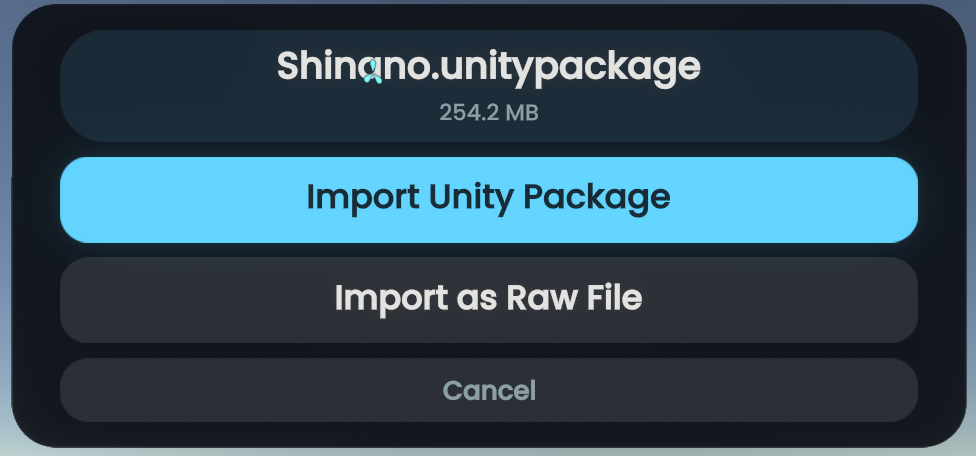
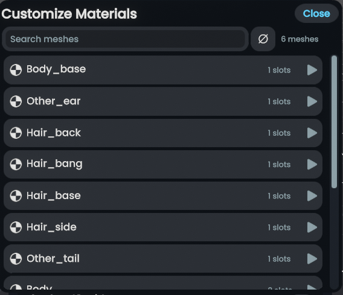
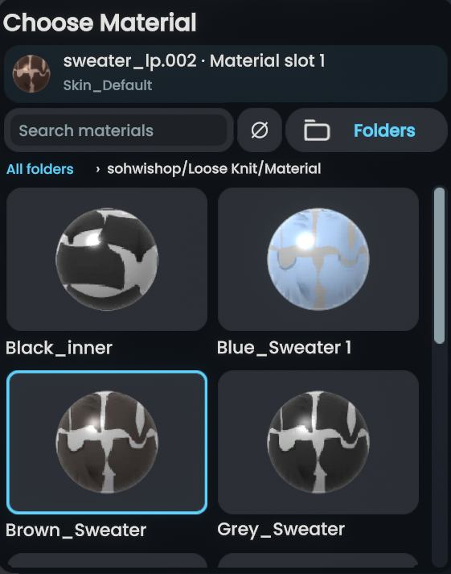
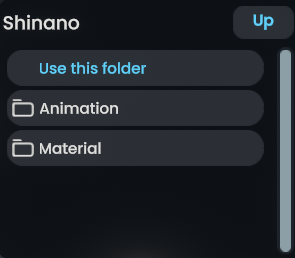

# Importing avatars

The importer reconstructs humanoid avatars from Unity packages and stages them for review before releasing them into the world.

## Import workflow

1. **Package intake**: Drag and drop a `.unitypackage` file into Resonite. The pre-import prompt displays the package name, file size, and provides three choices:
    - **Import Unity Package**: Launches the interactive staging station to reconstruct, inspect, and configure avatars and prefabs.
    - **Import as Raw File**: Bypasses the station and imports the file directly through Resonite's native file importer, the same way standard Resonite handles raw files.
    - **Cancel**: Aborts the operation without unpacking or importing.

    <figure markdown="span">
      { width="480" }
      <figcaption>The pre-import prompt modal shown when dropping a Unity package into Resonite.</figcaption>
    </figure>

2. **Station staging**: When you choose the station, the package is extracted to a dedicated cache and verified. Staged prefabs are prepared for inspection.
3. **Review and customize**: The station tablet displays each detected avatar or prefab:
    - **3D Turntable preview**: Rotate the avatar 360° using the interactive turntable slider on the preview pedestal.
    - **Material Customizer**: Open the material customizer to inspect mesh renderers and individual material slots, view material thumbnails and spheres, search materials by name, or navigate package folders using interactive breadcrumbs.
    - **Shader Presets**: Switch between **Automatic** (picks Xiexe Toon or PBS Metallic depending on shader and properties), **Toon** (explicit Xiexe Toon), and **PBS Metallic**.
    - **Status diagnostics**: View real-time item status (Ready, Partial compatibility, or Blocked) and detailed material warnings.
4. **Avatar creation**: Selecting **Create avatar** moves the model out of staging into the world with full avatar functionality:
    - Sets up the humanoid **BipedRig** and **VRIK** references.
    - Calibrates hand chirality and bone alignments.
    - Resolves and attaches the authored headset viewpoint.
    - Configures eye tracking (blinking, winking, and gaze behaviors).
    - Generates context menu controls for expression menus and parameter toggles.
    - Applies native avatar protection (if configured).
    - Attaches an in-world receipt recording package source, shader assignments, and visual approximations.

!!! warning "Staging hierarchy is world content"
    While an import is in progress, staged objects reside under an inactive global hierarchy in the world. Inactive staging is not an isolated local-only sandbox; other users present in the session can observe world state changes. If you are importing sensitive or private assets, perform the import in a private or local session.

## Material and shader handling

- **Shader presets**: Each item defaults to **Automatic** conversion. You can also explicitly override with **Toon** or **PBS**.
- **Item-level limitation warnings**: Visual approximations (such as unsupported blend modes, dynamic UV scrolling, unbaked lilToon layers, or second emission maps) are tracked as non-blocking limitations (`IsPartial = true`). The avatar remains structurally ready and can be created normally.
- **In-world receipts**: The importer attaches a persistent receipt to the avatar slot detailing the package source, assigned materials, and any visual limitations.

### Material customizer controls

The station's material customizer provides tools to examine and override materials and textures across all detected meshes:

-   **Mesh and slot list**

    ---

    

    Inspect all detected skinned mesh renderers, check submesh slot counts, and quickly locate specific parts using the search filter.

-   **Material sphere picker**

    ---

    

    Visual preview spheres render each material with realistic shading and reflections, letting you pick variants before committing.

-   **Package folder navigation**

    ---

    

    Browse texture and material folders within the extracted package to select and assign alternate assets directly.

