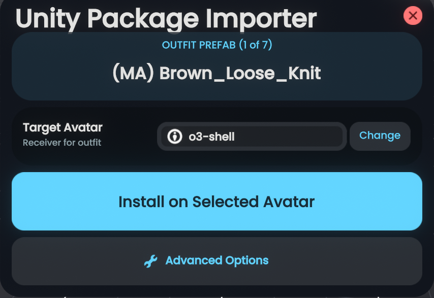
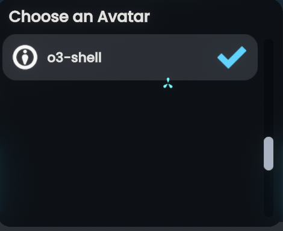

# Importing clothing

The importer supports modular outfits and attachments configured with Modular Avatar or VRCFury components.

## Outfit installation workflow

1. **Select an outfit item**: When a package contains clothing or props with `ModularAvatarMergeArmature`, `ModularAvatarBoneProxy`, or supported `VRCFuryArmatureLink` components, the station marks the item as an outfit prefab.

    <figure markdown="span">
      { width="560" }
      <figcaption>The station outfit installer panel showing detected Modular Avatar components and the target avatar selection.</figcaption>
    </figure>

2. **Choose a target avatar**: The station lists available avatars in the current world that are owned by the local user. Tap **Change** to select your target avatar from the list.

    <figure markdown="span">
      { width="380" }
      <figcaption>Target avatar picker listing owned avatars in the current session.</figcaption>
    </figure>

3. **Install**: Selecting **Install on Selected Avatar** duplicates the outfit into the target avatar's hierarchy, binds bones according to the authored plan, and configures skinned bounds.
4. **Context menu toggle**: If selected, the importer creates an outfit toggle in the avatar's context menu.

## Ownership and isolation

- **Target avatar protection**: Outfits can only be installed on avatars allocated by or protected for the local user. The station rejects targets owned by other users or currently worn by another player.
- **Transactional safety**: Installation operates on a duplicate copy. If an error occurs or the operation is cancelled, the transaction rolls back cleanly, destroying newly created slots and leaving the target avatar untouched.
- **Staging notice**: Uncommitted outfit templates remain in the station's inactive staging hierarchy until consumed or the station closes.
