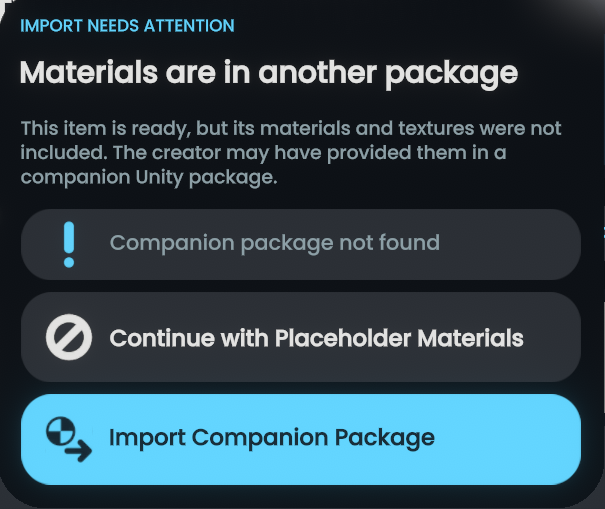
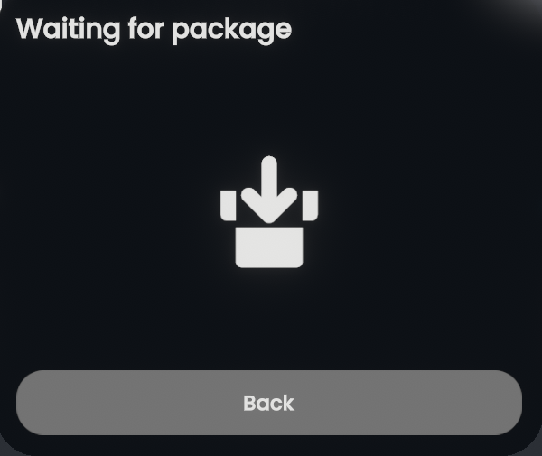

# Companion packages

Avatars often distribute shaders, materials, textures, or accessories in separate packages. The importer can merge companion packages into an active station to recover missing dependencies.

## Companion resolution

1. **Missing dependency detection**: If an imported avatar references textures or materials that were not included in the primary package, the station prompts that materials are in another package. You can choose **Import Companion Package**, **Continue with Placeholder Materials**, or cancel if unavailable.

    { width="480" }

    *The station notification prompt when an imported model requires companion materials.*

2. **Companion intake**: Tapping **Import Companion Package** arms the station to wait for external packages. Drag and drop companion `.unitypackage` files directly into the session.

    { width="360" }

    *The waiting state waiting for candidate companion packages to be dropped into the world.*

3. **Automatic recovery**: The importer extracts the companion package, indexes its assets, and re-resolves pending material slots and texture assignments automatically.
4. **Conflict rejection**: If a companion package contains an asset with a GUID identical to an existing asset but with differing payload content or metadata, the conflict is rejected symmetrically. The importer prevents arbitrary overwriting and logs the ambiguity.
